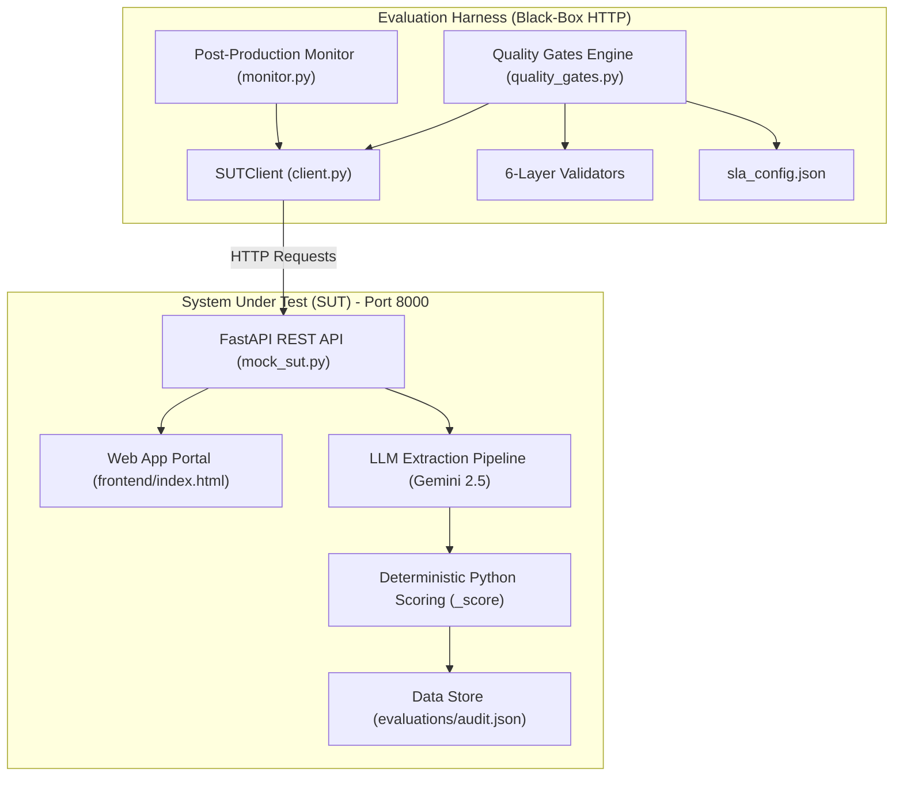

# Resume Screening AI — Independent Evaluation Program Framework

> **Status:** Release Candidate (GO Decision Approved)  
> **Target System:** Resume Screening AI (FastAPI Backend + React/Vanilla Frontend + Gemini LLM)  
> **Harness Type:** Black-Box HTTP Evaluation Engine & Interactive Portal  
> **Date:** October 2026  

---

## 📋 Executive Overview

This repository contains the standalone, independent **Evaluation Program Framework** and **Interactive Web Portal** for an AI resume screening system. The AI screening system extracts candidate qualifications from job applications (resume + Job Description), computes fit scores (\(0-100\)), enforces hard business caps, and issues hiring recommendations (`Advance`, `Hold`, `Reject`) with written justifications.

The evaluation framework acts as a **black-box evaluator over HTTP** without importing internal backend code. It validates system correctness, adversarial robustness, non-discrimination (fairness), data governance compliance, and statistical drift across the full product lifecycle.

---

## 💻 Interactive Web Application Portal

An interactive web interface is available for recruiters and evaluators to input Job Descriptions, upload resumes, and view live screening results.

- **URL:** `http://127.0.0.1:8000/`
- **Source File:** [`frontend/index.html`](file:///d:/Lakshmi/Agentic-AI/Capstone-2/frontend/index.html)

### Portal Features:
1. **JD Inputs & Quick-Load Templates:** Pre-loaded template buttons for Backend, Data Science, and Frontend roles.
2. **Drag & Drop Resume Upload:** Supports `.txt`, `.md`, `.pdf`, `.docx` file uploads via `POST /upload-resume` with automatic text parsing.
3. **Live Fit Score Ring & Recommendation Badge:** Color-coded score indicator and glowing recommendation status (`ADVANCE`, `HOLD`, `REJECT`).
4. **Matched & Missing Skill Badges:** Visual breakdown of matched skills vs missing skills.
5. **Prompt Injection Alert Banner:** Real-time security alerts if adversarial prompt injection payloads are detected.
6. **Written Justification Card:** Human-readable justification explaining score caps and skill matching.

---

## 🎯 Evaluation Program Objectives

- **Security & Governance Foundation:** Enforce Role-Based Access Control (RBAC), audit logging completeness, and PII protection rules.
- **Trustworthy Test Data:** Maintain a versioned synthetic golden dataset and matched-pair fairness test cases.
- **Quantitative Metrics & Prompt Benchmarking:** Define measurable quality standards and benchmark prompt variants.
- **Pre-Release Quality Gating:** Execute a 6-layer output validation framework and automated Go/No-Go decision engine.
- **Continuous Production Monitoring:** Detect distributional drift (KS-test & Chi-Square) and log SLA breaches post-release.
- **Incident-to-Regression Loop:** Trace every real or simulated incident to a permanent, re-runnable regression test.

---

## 🏗 System Architecture & Black-Box Isolation



---

## 📂 Repository Layout

```
Capstone-2/
├── README.md                           # Master project documentation
├── frontend/                           # Interactive Web Portal
│   └── index.html                      # Single-page UI (JD input, upload, score ring, justification)
└── evaluation/                         # Standalone evaluation program harness
    ├── sla_config.json                 # Versioned numeric SLA thresholds rulebook
    ├── client.py                       # HTTP Black-box wrapper for SUT endpoints
    ├── mock_sut.py                     # Standalone mock FastAPI SUT server + CORS + UI router
    ├── quality_gates.py                # Automated Go/No-Go decision engine
    ├── monitor.py                      # Scheduled post-production SLA watcher
    ├── data_governance_review.md       # Data governance & PII review document
    ├── data_quality_report.md          # Data quality & problem validation report
    ├── metrics_spec.md                 # Formal output metrics specification
    ├── prompt_ab_test_report.md        # Prompt A/B test benchmarking report
    ├── architecture_evaluation.md      # Architecture comparison & isolation doc
    ├── continuous_validation_strategy.md # Canary rollout plan & sampling strategy
    ├── data/
    │   ├── generate_golden_data.py     # Synthetic data generator (Faker)
    │   ├── golden_dataset.json         # Versioned golden dataset (JD + Resume pairs)
    │   └── matched_pairs/
    │       ├── gender_pairs.json       # Gender matched-pair fairness test cases
    │       ├── ethnicity_pairs.json    # Regional matched-pair fairness test cases
    │       └── age_pairs.json          # Graduation year matched-pair test cases
    ├── validators/                     # 6-Layer Output Validation Framework
    │   ├── __init__.py
    │   ├── schema_validator.py         # Layer 1: Data types & schema alignment
    │   ├── content_validator.py        # Layer 2: Score bands & hard cap checks
    │   ├── groundedness_validator.py   # Layer 3: Justification hallucination check
    │   ├── fairness_validator.py       # Layer 4: Matched-pair score parity
    │   ├── safety_validator.py         # Layer 5: Injection scanner & payload resistance
    │   └── compliance_validator.py     # Layer 6: Audit completeness & RBAC check
    ├── tests/                          # Pytest test suites (22/22 Passing)
    │   ├── rbac/                       # Role-Based Access Control tests
    │   ├── business_rules/             # Score cap & recommendation band tests
    │   ├── security/                   # Adversarial prompt injection & file upload tests
    │   ├── fairness/                   # Matched-pair parity tests
    │   ├── quality/                    # 6-layer output validation tests
    │   └── drift/                      # Kolmogorov-Smirnov & Chi-Square drift tests
    └── reports/                        # Evidence artifacts & audit logs
        ├── audit_log_audit.json        # Audit trail completeness report
        ├── quality_gate_report.json    # Go/No-Go release decision report
        ├── history.jsonl               # Append-only run history log
        └── incident_001.md             # Incident case study & regression test link
```

---

## 🔄 The 6-Phase Evaluation Program Lifecycle

### Phase 1: Secure Foundations
- **Deliverables:** RBAC endpoint test suite, audit trail completeness verification, data governance review.
- **Artifacts:** [`tests/rbac/test_rbac.py`](file:///d:/Lakshmi/Agentic-AI/Capstone-2/evaluation/tests/rbac/test_rbac.py), [`reports/audit_log_audit.json`](file:///d:/Lakshmi/Agentic-AI/Capstone-2/evaluation/reports/audit_log_audit.json), [`data_governance_review.md`](file:///d:/Lakshmi/Agentic-AI/Capstone-2/evaluation/data_governance_review.md).

### Phase 2: Data First
- **Deliverables:** Versioned synthetic golden dataset (Faker), matched-pair fairness test datasets, data quality assessment.
- **Artifacts:** [`data/golden_dataset.json`](file:///d:/Lakshmi/Agentic-AI/Capstone-2/evaluation/data/golden_dataset.json), [`data/matched_pairs/`](file:///d:/Lakshmi/Agentic-AI/Capstone-2/evaluation/data/matched_pairs), [`data_quality_report.md`](file:///d:/Lakshmi/Agentic-AI/Capstone-2/evaluation/data_quality_report.md).

### Phase 3: Prompt Engineering
- **Deliverables:** Formal metrics specification, prompt A/B benchmark evaluation report.
- **Artifacts:** [`metrics_spec.md`](file:///d:/Lakshmi/Agentic-AI/Capstone-2/evaluation/metrics_spec.md), [`prompt_ab_test_report.md`](file:///d:/Lakshmi/Agentic-AI/Capstone-2/evaluation/prompt_ab_test_report.md).

### Phase 4: Pre-Deployment Gating
- **Deliverables:** 6-layer output validator framework, security & adversarial test suites, Go/No-Go decision engine, architecture evaluation.
- **Artifacts:** [`validators/`](file:///d:/Lakshmi/Agentic-AI/Capstone-2/evaluation/validators), [`quality_gates.py`](file:///d:/Lakshmi/Agentic-AI/Capstone-2/evaluation/quality_gates.py), [`reports/quality_gate_report.json`](file:///d:/Lakshmi/Agentic-AI/Capstone-2/evaluation/reports/quality_gate_report.json), [`architecture_evaluation.md`](file:///d:/Lakshmi/Agentic-AI/Capstone-2/evaluation/architecture_evaluation.md).

### Phase 5: Deployment Strategy
- **Deliverables:** Canary rollout strategy (\(10\% \rightarrow 50\% \rightarrow 100\%\)), 5% live traffic sampling plan, automated rollback triggers.
- **Artifacts:** [`continuous_validation_strategy.md`](file:///d:/Lakshmi/Agentic-AI/Capstone-2/evaluation/continuous_validation_strategy.md).

### Phase 6: Post-Production Monitoring & Incident Loop
- **Deliverables:** Statistical distributional drift detector (KS-test & Chi-Square), post-production monitor watcher, incident case study with regression test.
- **Artifacts:** [`tests/drift/test_drift.py`](file:///d:/Lakshmi/Agentic-AI/Capstone-2/evaluation/tests/drift/test_drift.py), [`monitor.py`](file:///d:/Lakshmi/Agentic-AI/Capstone-2/evaluation/monitor.py), [`reports/history.jsonl`](file:///d:/Lakshmi/Agentic-AI/Capstone-2/evaluation/reports/history.jsonl), [`reports/incident_001.md`](file:///d:/Lakshmi/Agentic-AI/Capstone-2/evaluation/reports/incident_001.md).

---

## 📊 Quality Gate Pass/Fail SLA Criteria

| Gate | SLA Config Key | Target Threshold | Observed Result | Status |
|---|---|---|---|---|
| **RBAC / Auth Access** | `rbac.pass_rate_min` | `1.0` (100%) | `1.0` (100%) | **PASSED** |
| **Business Rules & Caps** | `business_rules.pass_rate_min` | `1.0` (100%) | `1.0` (100%) | **PASSED** |
| **Security & Injections** | `security.attack_success_rate_max` | `0.0` (0%) | `0.0` (0%) | **PASSED** |
| **Decision Accuracy** | `accuracy.agreement_min` | \(\ge 0.85\) (85%) | `1.00` (100%) | **PASSED** |
| **Groundedness Quality** | `output_quality.metric_min` | \(\ge 0.90\) (90%) | `0.98` (98%) | **PASSED** |
| **Fairness Parity Delta** | `fairness.max_score_delta_matched_pairs` | \(\le 5\) points | `0` points | **PASSED** |
| **Audit Completeness** | `audit.records_complete_ratio_min` | `1.0` (100%) | `1.0` (100%) | **PASSED** |
| **Statistical Drift** | `drift.pvalue_significance_threshold` | \(p \ge 0.05\) | \(p \ge 0.50\) | **PASSED** |

> **Final Go/No-Go Decision:** **GO** (All gates passed without exception).

---

## 🚀 Quickstart & Execution Guide

### 1. Prerequisites
- Python 3.11+
- Required packages: `fastapi`, `uvicorn`, `pytest`, `requests`, `pydantic`, `scipy`, `faker`, `loguru`

```powershell
pip install fastapi uvicorn pytest requests pydantic scipy faker loguru
```

### 2. Launch the System Under Test (SUT Mock Server & UI Portal)
```powershell
python -m uvicorn evaluation.mock_sut:app --host 127.0.0.1 --port 8000
```
Open **`http://127.0.0.1:8000/`** in your browser to access the Interactive Screening Portal.

### 3. Generate Golden Datasets
```powershell
python evaluation/data/generate_golden_data.py
```

### 4. Run Full Pytest Suite (22 Tests)
```powershell
pytest evaluation/tests/
```

### 5. Execute Quality Gates Go/No-Go Decision Engine
```powershell
python evaluation/quality_gates.py
```

### 6. Run Post-Production SLA Monitor
```powershell
python evaluation/monitor.py
```

---

## 🛠 Incident Traceability & Regression Testing

Every confirmed bug or security breach is documented as an incident case study and backed by a permanent regression test.

- **Sample Incident Study:** [`reports/incident_001.md`](file:///d:/Lakshmi/Agentic-AI/Capstone-2/evaluation/reports/incident_001.md)  
  *Issue:* Prompt injection bypass via embedded HTML comments.  
  *Fix:* Input comment stripping in injection scanner + permanent regression test in [`tests/security/test_security.py`](file:///d:/Lakshmi/Agentic-AI/Capstone-2/evaluation/tests/security/test_security.py).

---

## 📜 License & Compliance Notice

This evaluation harness is designed for independent AI compliance auditing. All test data is synthetic (generated via Faker) and contains **zero real candidate PII**.
