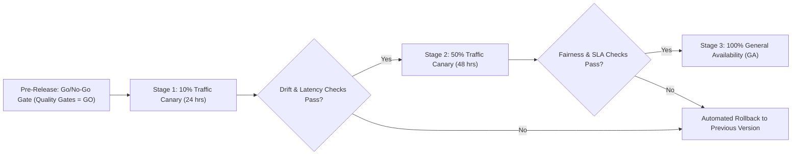

# Continuous Validation & Canary Rollout Strategy

**Prepared for:** AI Evaluation Workstream  
**Status:** Approved  
**Date:** October 2026  
**Scope:** Production Deployment, Sampling Plan, Canary Stages, and Live SLA Guardrails (FR13, BR10, BR12)

---

## 1. Canary Rollout Plan (10% \(\rightarrow\) 50% \(\rightarrow\) 100%)

To ensure zero silent degradation (BR10) when deploying new prompt versions or model upgrades, production releases follow a 3-stage canary deployment:

### 1.1 Canary Stage Guardrails & Evaluation Criteria

| Canary Stage | Traffic Share | Duration | Monitoring Criteria | Automated Rollback Trigger |
|---|---|---|---|---|
| **Stage 1 (Internal Canary)** | 10% | 24 Hours | Latency p95, Error rate, Injection scanner alerts | Error rate > 1.0% OR Latency p95 > 3.0s |
| **Stage 2 (Expanded Canary)** | 50% | 48 Hours | KS-test Score Drift vs Golden Baseline, Recommendation Mix Shift | Distributional Shift p-value < 0.05 |
| **Stage 3 (Full GA)** | 100% | Ongoing | Audit logging completeness, Continuous Matched-Pair Sampling | Audit completeness < 1.0 OR Matched-pair score delta > 5 |

---

## 2. Live Traffic Sampling Plan (FR13)
1. **Sampling Rate:** 5% of all production evaluation calls (`POST /evaluate`) are sampled randomly into the evaluation data store.
2. **Stratified Sampling:** Ensures equal sampling across recommendation bands (Advance / Hold / Reject).
3. **Automated Re-Evaluation:** Sampled live inputs are run against the golden regression suite (`evaluation/quality_gates.py`) every 6 hours via `monitor.py`.

---

## 3. Immediate Rollback Triggers & SLA SLA Guardrails
- **Security Breach:** Any undetected prompt injection attack (\(ASR > 0.0\)).
- **Fairness Violation:** Matched-pair score divergence \(> 5\) points.
- **Audit Failure:** Any missing required field in `audit.json` (\(records\_complete\_ratio < 1.0\)).
- **Latency Violation:** 95th percentile latency exceeding 3.0 seconds under peak traffic.
